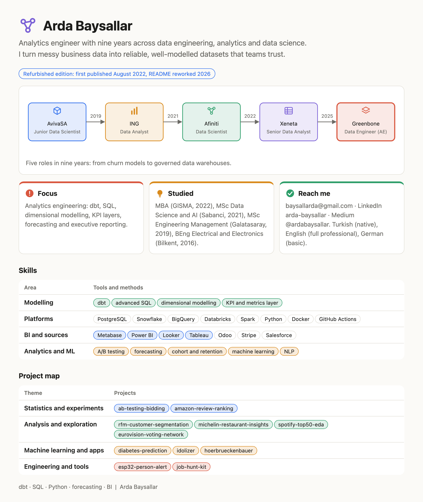

# Hi, I'm Arda Baysallar

**Analytics engineer · Data scientist · MBA**

> **Refurbished edition.** This profile grew out of my first one, published in August 2022 (now archived as [`profile-archive-2022`](https://github.com/ardabaysallar/profile-archive-2022)). It was reworked in November 2026.

## About

I have nine years of experience across data engineering, analytics and data science. I like turning messy business data into reliable, well-modelled datasets that Finance, Sales and leadership trust, and I enjoy building things that run on real devices.

Ask me about statistics, data analytics and engineering. Bonus topic: history.

## Experience

**Greenbone AG** · Data Engineer (Analytics Engineering) · Apr 2025 - present  
Built a data warehouse end to end with dbt: one governed source of truth, central KPI definitions, forecasting and executive reporting.

**Xeneta** · Senior Data Analyst · Nov 2022 - Apr 2025  
Led a Snowflake migration, built dbt and ETL pipelines, and Power BI dashboards for Customer Solutions, Marketing, Sales and Customer Success.

**Afiniti** · Data Scientist · May 2021 - Mar 2022  
Built AI models for customer-agent matching, with continuous testing, retraining, versioning and deployment.

**ING** · Data Analyst · Aug 2019 - Jan 2021  
Credit risk analytics, A/B tests, customer segmentation and machine learning on credit data.

**AvivaSA** · Junior Data Scientist · Aug 2016 - Jan 2019  
Predictive models for customer churn.

## Skills

- **Modelling:** dbt, advanced SQL, dimensional modelling, KPI and metrics layer
- **Platforms:** PostgreSQL, Snowflake, BigQuery, Databricks, Spark, Python, Docker, GitHub Actions
- **BI and sources:** Metabase, Power BI, Looker, Tableau, Odoo, Stripe, Salesforce
- **Analytics and ML:** A/B testing, forecasting, cohort and retention analysis, machine learning, NLP

## Education and certifications

- MBA, Global Management, GISMA Business School, Berlin (2022)
- MSc Data Science and Artificial Intelligence, Sabanci University (2021)
- MSc Engineering Management, Galatasaray University (2019)
- BEng Electrical and Electronics Engineering, Bilkent University (2016)
- Certifications: dbt Fundamentals; Supervised Machine Learning: Regression and Classification; Machine Learning; Big Data; Miuul: Measurement Problems, Statistics for Data Science, Recommendation Systems, Time Series
- Volunteering: mentor at the Miuul Data Science Bootcamp (2022-2023)

## Projects

| Theme | Projects |
|---|---|
| **Statistics and experiments** | [ab-testing-bidding](https://github.com/ardabaysallar/ab-testing-bidding) (A/B test with assumption checks) · [amazon-review-ranking](https://github.com/ardabaysallar/amazon-review-ranking) (fair ratings and review ranking) |
| **Analysis and exploration** | [rfm-customer-segmentation](https://github.com/ardabaysallar/rfm-customer-segmentation) (customer segments) · [michelin-restaurant-insights](https://github.com/ardabaysallar/michelin-restaurant-insights) (restaurant guide insights) · [spotify-top50-eda](https://github.com/ardabaysallar/spotify-top50-eda) (Spotify top-50 by country) · [eurovision-voting-network](https://github.com/ardabaysallar/eurovision-voting-network) (Eurovision voting network) |
| **Machine learning and apps** | [diabetes-prediction](https://github.com/ardabaysallar/diabetes-prediction) (diabetes classification) · [idolizer](https://github.com/ardabaysallar/idolizer) (CV vs dream job skill gaps) · [hoerbrueckenbauer](https://github.com/ardabaysallar/hoerbrueckenbauer) (live German speech to text on the phone) |
| **Engineering and tools** | [esp32-person-alert](https://github.com/ardabaysallar/esp32-person-alert) (person detection on a microcontroller) · [job-hunt-kit](https://github.com/ardabaysallar/job-hunt-kit) (skills for a daily job search) |

## Writing and contact

- Articles: [medium.com/@ardabaysallar](https://medium.com/@ardabaysallar)
- LinkedIn: [arda-baysallar](https://www.linkedin.com/in/arda-baysallar/)
- Email: baysallarda@gmail.com
